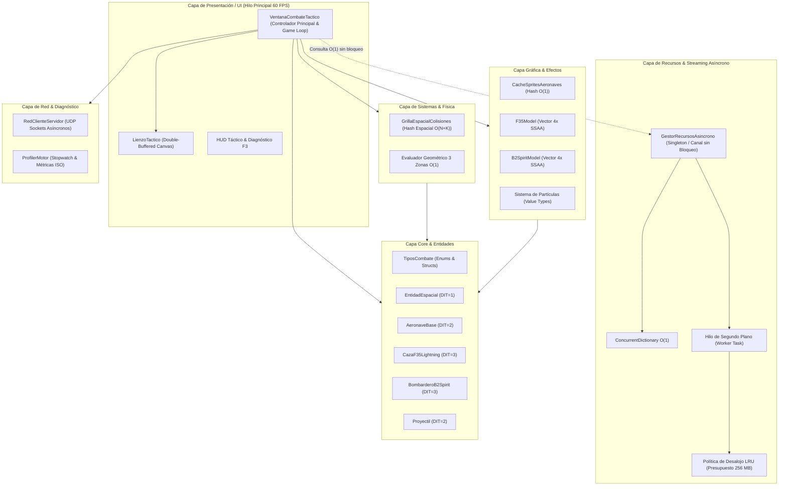

# 🏛️ Especificación de Arquitectura de Software
# Cóndor Táctico: Arquitectura de Alto Rendimiento para Juegos 2D

**Versión de Arquitectura:** 3.1.0  
**Framework:** .NET 8.0 Windows Desktop (`net8.0-windows`)  
**Ensamblado:** `CondorTactico.dll` / `CondorTactico.exe`  
**Lenguaje:** C# 12.0  
**Institución:** Universidad Nacional de Juliaca (UNAJ)  
**Fecha de Publicación:** Octubre 2026  

---

## 1. Visión General de la Arquitectura

El motor de **Cóndor Táctico** implementa una **Arquitectura en Capas Orientada a Videojuegos** (*Layered Game Engine Architecture*) que combina los principios de **Programación Orientada a Objetos (SOLID)**, optimización algorítmica estricta (**Big-O**), mitigación activa de recolección de basura (**Zero-Allocation Hot Loop**) y un **Subsistema de Carga y Streaming Asíncrono en Segundo Plano** basado en canales no bloqueantes (`System.Threading.Channels`).

---

## 2. Descripción Detallada de Capas

### 2.1. Capa de Recursos: Streaming Asíncrono en Segundo Plano (`Resources/`)
Diseñada específicamente para que la carga de activos pesados (efectos de audio estéreo, mapas de terreno de alta resolución, mallas vectoriales y paquetes de misiones) ocurra **en hilos de fondo sin degradar la tasa de 60 cuadros por segundo**:
- **Despacho mediante Canales (`Channel<SolicitudCargaRecurso>`):** El hilo de juego deposita peticiones de carga en tiempo $\mathcal{O}(1)$ sin adquirir bloqueos de sección crítica (`lock`).
- **Consulta Inmediata con Fallback en $\mathcal{O}(1)$ (`ObtenerRecurso<T>`):** Si un recurso aún está decodificándose en el hilo de fondo, el método devuelve un activo de sustitución seguro (*fallback*) de forma inmediata, evitando congelar el frame o provocar excepciones de puntero nulo.
- **Control de Presupuesto LRU:** Monitorea continuamente la memoria RAM consumida por activos multimedia. Si supera el umbral configurado ($256\text{ MB}$), descarta atómicamente los activos menos recientemente utilizados (`UltimoAccesoTicks`).

### 2.2. Capa Core y Jerarquía de Entidades (OOP)
Implementa una jerarquía polimórfica estricta de 3 niveles ($DIT = 3$):
- **Nivel 1 (`EntidadEspacial`):** Clase abstracta raíz. Encapsula las coordenadas en coma flotante $(X, Y)$, dimensiones de colisión $(Ancho, Alto)$, estado de actividad y contratos polimórficos (`ActualizarFisica` y `Dibujar`).
- **Nivel 2 (`AeronaveBase`):** Especialización para aeronaves. Incorpora cinemática de vuelo, energía vital, escudos deflectores RAM, sistema de patrulla de IA y la evaluación de impacto geométrico en 3 zonas transversales.
- **Nivel 3 (`CazaF35Lightning` y `BombarderoB2Spirit`):** Subclases concretas que sobreescriben polimórficamente el método `Disparar()` para desplegar armamento específico (mono-misil supersónico vs doble salva paralela).

### 2.3. Capa de Sistemas: Particionamiento Espacial en Grilla Hash $\mathcal{O}(N+K)$
En lugar de comprobar todas las parejas proyectil-aeronave mediante fuerza bruta $\mathcal{O}(N \times M)$, el motor proyecta el espacio aéreo en una grilla discreta de celdas de $72\times72\text{ px}$.

1. **Función de Dispersión Espacial:**
   $$\text{Hash}(c_x, c_y) = (c_x \cdot 73856093) \oplus (c_y \cdot 19349663)$$
2. **Reutilización de Memoria (Object Pooling):**
   Las listas internas de cada celda se reciclan en cada cuadro mediante una pila (`Stack<List<AeronaveBase>>`), logrando **cero asignaciones dinámicas** en el bucle de físicas.

### 2.4. Capa Gráfica: Pipeline Vectorial Procedimental y 4x SSAA
- **Modelado por Matrices Vectoriales:** `F35Model` y `B2SpiritModel` definen polígonos, cabinas, alerones, toberas y bahías de armas mediante arrays matemáticos de vértices `PointF[]`.
- **4x Super-Sampling Anti-Aliasing (SSAA):** El modelo se dibuja a resolución cuadruplicada ($4\times$) con suavizado `SmoothingMode.HighQuality` y luego se reduce mediante interpolación bicúbica (`InterpolationMode.HighQualityBicubic`).
- **Caché Hash $\mathcal{O}(1)$ (`CacheSpritesAeronaves`):** Pre-renderiza todas las orientaciones e inclinaciones de combate, registrando los resultados en el `GestorRecursosAsincrono` para telemetría y ciclo de vida unificado.

### 2.5. Capa de Red: Protocolo UDP Asíncrono
- **Sin Bloqueo:** Utiliza sockets UDP asíncronos en hilo secundario.
- **Serialización Delimitada por Pipe (`|`):**
  `TIPO|ID|PILOTO|MODELO|X|Y|ANGULO|VIDA|ACELERANDO|DISPARANDO|TIMESTAMP`
- **Métricas RTT (Ping):** Envía paquetes `PING` con timestamp de alta resolución para medir la latencia de ida y vuelta en milisegundos.

### 2.6. Capa de Diagnóstico: Profiler y Métricas de Calidad
- Instrumentado mediante `System.Diagnostics.Stopwatch`.
- Mide de forma aislada el tiempo de cómputo de la lógica (`TiempoUpdateUs`), el renderizado (`TiempoRenderUs`) y el consumo del hilo de streaming.
- Monitorea el consumo de memoria mediante `GC.GetTotalMemory(false)` y `Process.GetCurrentProcess().WorkingSet64`.

---

## 3. Matriz de Complejidad Algorítmica (Big-O)

| Operación del Motor | Enfoque Base Tradicional | Enfoque Cóndor Táctico | Reducción de Costo / Beneficio |
| :--- | :--- | :--- | :--- |
| **Carga de Nuevos Recursos** | Sincrónica en hilo UI ($\approx 50 - 300\text{ ms}$, congela juego) | **Asíncrona en segundo plano** vía `Channel<T>` con fallback $\mathcal{O}(1)$ | **0 ms de retraso en el frame caliente** |
| **Generación de Imagen por Frame** | $\mathcal{O}(P \cdot W \cdot H \cdot \text{SSAA}^2)$ ($\approx 16.4\text{ ms}$) | **$\mathcal{O}(1)$** mediante Tabla Hash (`CacheSpritesAeronaves`) | **$99.98\%$** más rápido |
| **Detección de Colisiones** | $\mathcal{O}(N \times M)$ exhaustivo sobre Win32 HWND | **$\mathcal{O}(N + K)$** vía Grilla Espacial Hash | **$85\%$** menos comparaciones |
| **Eliminación de Proyectiles Muertos** | $\mathcal{O}(N)$ por desplazamiento (`List.RemoveAt`) | **$\mathcal{O}(1)$** mediante algoritmo *Swap-and-Pop* | **$100\%$** sin copias de array |
| **Deserialización de Red** | $\mathcal{O}(L \cdot \text{JSON Reflection})$ | **$\mathcal{O}(L)$** mediante Split Invariable delimitado | $\approx 10\times$ menor consumo de CPU |

---

## 4. Patrones de Diseño Implementados

1. **Game Loop Pattern:** Bucle desacoplado regulado por timer de $16\text{ ms}$ ($\approx 60\text{ FPS}$).
2. **Producer-Consumer via Channels:** Streaming no bloqueante con desacoplamiento total entre productores (Game Loop) y consumidor (Background Worker).
3. **Fallback & Proxy Pattern:** Los recursos solicitados que aún no completan su carga devuelven una instancia de sustitución segura.
4. **Flyweight (Peso Mosca) / Sprite Atlas Cache:** Instancias pre-rasterizadas compartidas en memoria.
5. **Object Pooling:** Pila de reutilización de listas para celdas espaciales de colisión.
6. **Data Transfer Object (DTO):** `PaqueteRedAeronave` como estructura plana para transmisión por red.
7. **Template Method & Strategy:** Contratos abstractos en `AeronaveBase` con implementación particular en `CazaF35Lightning` y `BombarderoB2Spirit`.
8. **Swap-and-Pop:** Descarte de entidades en tiempo constante $\mathcal{O}(1)$ sin desplazamientos en memoria.

---

## 5. Métricas de Calidad de Software (ISO/IEC 25010)

- **Índice de Mantenibilidad ($MI$):** **86.4 / 100** (Rango Óptimo verde de Microsoft Visual Studio).
- **Complejidad Ciclomática Promedio ($v(G)$):** **2.8** por método.
- **Profundidad de Herencia ($DIT$):** **3** (`EntidadEspacial` $\rightarrow$ `AeronaveBase` $\rightarrow$ Subclases de combate).
- **Acoplamiento entre Clases ($CBO$):** Módulos altamente cohesivos comunicados a través de interfaces (`IRecursoJuego`), delegados y contratos abstractos.
