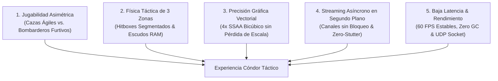
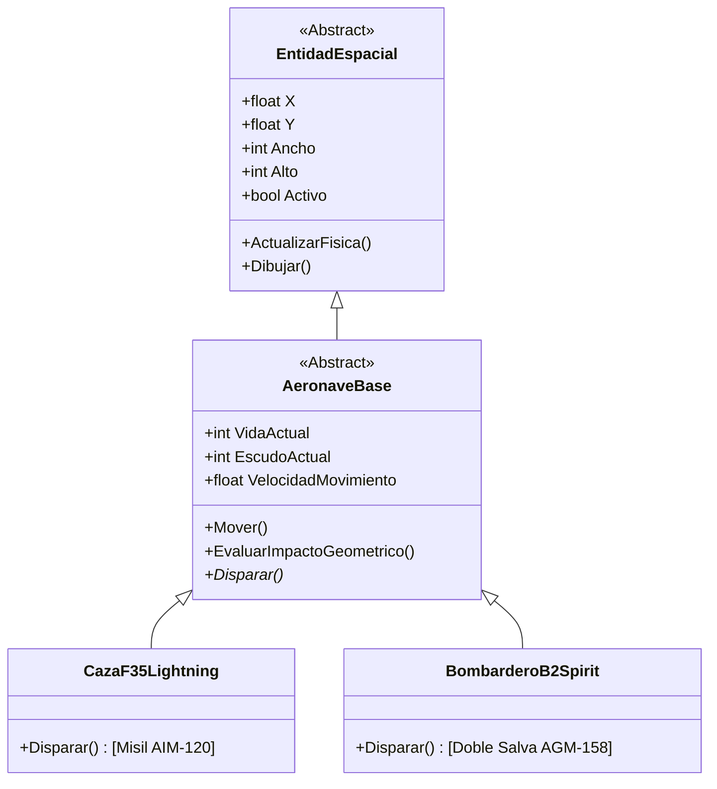

# 📖 Game Design Document (GDD)
# Cóndor Táctico: Tactical Air Combat Simulator

**Versión del Documento:** 3.1.0  
**Fecha:** Octubre 2026  
**Institución:** Universidad Nacional de Juliaca (UNAJ)  
**Equipo de Diseño y Desarrollo:**  
- Ronal Abelin Larico Ccaso  
- Clever Nandor Mamani Huallpa  
- Jhon Yossep Hinojosa Apaza  
- Jhon Alex Huaracallo Sucari  
- Hector Carlos Torres Flores  

---

## 1. Resumen Ejecutivo (High Concept)

**Cóndor Táctico** es un videojuego de combate aéreo táctico 2D en tiempo real (*Top-Down Dogfight Simulator*) que fusiona la adrenalina de los arcades clásicos de aviación militar con el rigor matemático, la optimización algorítmica y la precisión de un simulador contemporáneo. 

Bautizado en honor al soberano de las cumbres andinas, el jugador asume el control del **Escuadrón Cóndor** pilotando aeronaves de vanguardia (el caza polivalente **Lockheed Martin F-35A Lightning II** y el bombardero estratégico furtivo **Northrop Grumman B-2 Spirit**) en el teatro de operaciones de la estratosfera andina y global. Enfrenta escuadrones rivales gobernados por Inteligencia Artificial táctica o pilotos remotos en red local a través de datagramas UDP asíncronos.

---

## 2. Pilares Fundamentales de Diseño



1. **Combate Aéreo Asimétrico**: Cada aeronave posee atributos cinemáticos radicalmente distintos, hitboxes proporcionales a su envergadura, escudos electrostáticos/RAM y patrones balísticos específicos.
2. **Daño Segmentado en 3 Zonas**: Se descarta el concepto de "daño genérico por colisión simple". Disparar a las alas inflige desgaste superficial ($-1\text{ HP}$), mientras que atravesar la carlinga o cabina central asesta un golpe crítico devastador ($-10\text{ HP}$).
3. **Fidelidad Visual Vectorial Procedimental**: Las aeronaves son sintetizadas en tiempo de ejecución a partir de primitivas geométricas vectoriales con suavizado **4x SSAA**, garantizando nitidez quirúrgica sin compresión de texturas rasterizadas.
4. **Streaming Asíncrono de Recursos en Segundo Plano**: Carga no bloqueante de activos futuros (audio, mallas vectoriales, mapas) mediante canales concurrentes, asegurando **cero congelamientos** en el frame caliente.
5. **Respuesta Inmediata y Telemetría Transparente**: Bucle de juego a 60 FPS fijos con menos de $1\text{ ms}$ de cómputo por cuadro, auditado en vivo con la tecla **`F3`**.

---

## 3. Ambientación y Narrativa Táctica

El conflicto se desarrolla a $50,000\text{ pies}$ sobre el nivel del mar en el espacio aéreo estratosférico de alta tensión geopolítica. En este techo de vuelo, los aviones vuelan entre nubes cirroestratos a velocidades transónicas y supersónicas, donde el sigilo, la gestión del blindaje y la intercepción precisa de misiles definen la supervivencia del piloto. El piloto insignia **`CÓNDOR-01`** lidera las patrullas de intercepción táctica.

---

## 4. Ficha Técnica de Aeronaves Jugables



### 4.1. Lockheed Martin F-35A Lightning II
- **Rol:** Caza Polivalente de Dominio Aéreo de Quinta Generación.
- **Matrícula:** `AF-15-5104`.
- **Dimensiones:** $84 \times 118\text{ px}$.
- **Puntos de Estructura (HP):** $25\text{ HP}$ (Jugador) / $50\text{ HP}$ (Rival).
- **Escudo:** $5\text{ pts}$ (Protección básica de titanio).
- **Velocidad de Crucero:** $12.0\text{ px/tick}$ ($\text{Mach } 1.6$ simulado).
- **Armamento:**
  - Proyectil: **AIM-120 AMRAAM** (Misil Supersónico Aire-Aire).
  - Patrón: Fuego frontal lineal centrado.
  - Velocidad del Misil: $14.0\text{ px/tick}$.
  - Cadencia: $8\text{ ticks}$ de enfriamiento.
  - Perfil de Daño: $-10\text{ HP}$ Cabina / $-1\text{ HP}$ Alas.

### 4.2. Northrop Grumman B-2 Spirit ("Spirit of Mississippi")
- **Rol:** Bombardero Estratégico Furtivo de Penetración Profunda.
- **Matrícula:** `AF-82-1071` (Recreación exacta del bombardero real).
- **Dimensiones:** $132 \times 92\text{ px}$ (Ala volante con silueta de bordes dentados).
- **Puntos de Estructura (HP):** $35\text{ HP}$ (Jugador) / $60\text{ HP}$ (Rival).
- **Escudo RAM (Radar Absorbent Material):** $12\text{ pts}$ (Absorbe impactos colaterales alares antes de dañar el casco).
- **Velocidad de Crucero:** $10.0\text{ px/tick}$ ($\text{Mach } 0.95$ simulado).
- **Armamento:**
  - Proyectil: **AGM-158 JASSM** (Misiles de Crucero Furtivos).
  - Patrón: **Doble Salva Táctica Paralela** desde bahías de carga interna izquierda y derecha con dispersión divergente ($\pm 0.25\text{ px/tick}$).
  - Velocidad del Misil: $12.8\text{ px/tick}$.
  - Cadencia: $12\text{ ticks}$ de enfriamiento.
  - Perfil de Daño: $-10\text{ HP}$ Cabina / $-2\text{ HP}$ Alas.

---

## 5. Mecánicas de Vuelo y Combate

### 5.1. Sistema de Inclinación Dinámica (Banking)
Cuando el piloto vira horizontalmente (`A`/`D` o flechas), la aeronave rota visualmente $\pm15^\circ$ en tiempo real. Esta inclinación es recuperada desde una tabla hash pre-optimizada en $\mathcal{O}(1)$ para preservar el frame-rate.

### 5.2. Evaluación de Impacto en 3 Zonas Transversales
Dado un proyectil con centro $X_p$ y una aeronave con posición $X_n$ y ancho $W$:
$$\text{Segmento} = \frac{W}{3}$$
- **Zona 1 (Ala Izquierda):** $[X_n, X_n + \text{Segmento}[$ $\rightarrow$ Daño superficial absorbible por el escudo.
- **Zona 2 (Cabina Central):** $[X_n + \text{Segmento}, X_n + 2\cdot\text{Segmento}]$ $\rightarrow$ **Impacto Crítico Perforante**. Ignora el escudo y resta directamente $10\text{ HP}$ a la estructura.
- **Zona 3 (Ala Derecha):** $]X_n + 2\cdot\text{Segmento}, X_n + W]$ $\rightarrow$ Daño superficial absorbible por el escudo.

```
       Ala Izquierda           Cabina Central           Ala Derecha
    [     -1 HP     ]   |   [   -10 HP CRÍTICO   ]   |   [     -1 HP     ]
    0 -------------- W/3 ------------------------ 2W/3 ------------- W
```

---

## 6. Arquitectura de Streaming y Recursos en Segundo Plano

Para soportar la futura incorporación de efectos de sonido espaciales (`.wav`/`.ogg`), mallas de aeronaves adicionales y escenarios con biomas variables:
- El motor delega las operaciones pesadas de E/S de disco a un hilo trabajador desacoplado (`GestorRecursosAsincrono`).
- Los métodos de renderizado consumen recursos con complejidad temporal $\mathcal{O}(1)$ desde una caché protegida (`ConcurrentDictionary`).
- Ante una solicitud de un recurso no cargado, el juego no espera ni se congela: devuelve un *fallback* temporal mientras la carga concluye en segundo plano.

---

## 7. Inteligencia Artificial y Patrulla Táctica

Las aeronaves enemigas autónomas implementan:
- **Patrulla Transversal:** Vuelo en zigzag constante barriendo el espacio aéreo con rebote amortiguado en los bordes de la pantalla.
- **Oscilación Vertical Senoidal:** Variación sinusoidal en altura:
  $$Y(t) = 18 + \sin(\omega t) \cdot 14$$
- **Disparo Autónomo:** Cadencia cronometrada sincronizada con la proximidad del caza enemigo.

---

## 8. Arquitectura Multijugador (UDP Sockets)

El juego soporta partidas 1 vs 1 y combates en red local:
1. **Modo Host (Servidor):** Escucha datagramas UDP en el puerto `5050` (configurable) y retransmite telemetría a observadores.
2. **Modo Cliente (Piloto Remoto):** Envía su estado cinemático a la IP del Host a $30\text{ Hz}$ y calcula la latencia RTT.
3. **Modo Local (Single Player):** Combate directo contra la IA de la computadora.

---

## 9. Diseño de Interfaz de Usuario (UI & HUD)

1. **Barra Superior de Lanzamiento Táctico:**
   - Campo de Identificación de Piloto / Escuadrón (`txtPiloto`, predeterminado en `CÓNDOR-01`).
   - Selectores dinámicos de aeronave del jugador y rival (`cmbModeloJugador`, `cmbModeloRival`).
   - Selector de Modo de Red (`cmbModoRed`).
   - Botón de Despliegue Inmediato (`btnLanzar`), Escolta Aliada (`btnEscolta`) y Exportación de Métricas (`btnExportar`).
2. **Lienzo Estratosférico (Viewport):**
   - Fondo azul de alta atmósfera (`Color.FromArgb(24, 58, 98)`).
   - Nubes procedurales con paralaje aéreo.
   - Textos flotantes de combate con disolución alfa y desplazamiento vertical.
3. **HUD Táctico en Vivo (`F3`):**
   - Contador de cuadros por segundo (FPS).
   - Cronometría de CPU ($\mu\text{s}$ por frame).
   - Consumo de RAM y estadísticas del Garbage Collector.
   - Diagnóstico Big-O en vivo ($\mathcal{O}(N+K)$ vs $\mathcal{O}(N \times M)$).
   - Telemetría de streaming en segundo plano (recursos en caché y cola de fondo).
   - Latencia RTT de red.
