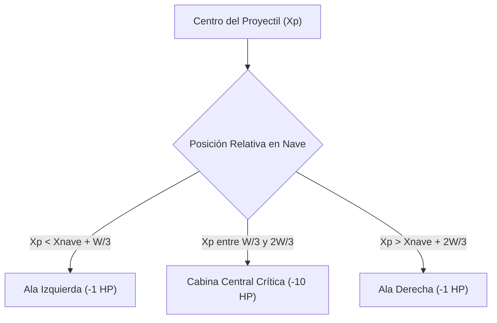

# ⚔️ Manual Matemático y Técnico del Sistema de Combate
# Cóndor Táctico: Aerodynamics, Ballistics & Combat Math

**Módulo:** `Core`, `Entities` y `Systems`  
**Institución:** Universidad Nacional de Juliaca (UNAJ)  
**Fecha:** Octubre 2026  

---

## 1. Sistema de Coordenadas y Cinemática 2D

El simulador opera en un espacio cartesiano euclidiano 2D con origen $(0,0)$ en la esquina superior izquierda del lienzo:
- Eje $+X$: Hacia la derecha (amplitud horizontal del espacio aéreo).
- Eje $+Y$: Hacia abajo (profundidad estratosférica).

### Cinemática de Aeronave
La posición de la aeronave en el frame $t + \Delta t$ se actualiza como:
$$X_{t+1} = \text{Clamp}(X_t + \mathbf{v}_x \cdot V_{\text{crucero}}, 4, W_{\text{mapa}} - W_{\text{nave}} - 4)$$
$$Y_{t+1} = \text{Clamp}(Y_t + \mathbf{v}_y \cdot V_{\text{crucero}}, 4, H_{\text{mapa}} - H_{\text{nave}} - 34)$$

Donde $\mathbf{v}_x \in \{-1, 0, 1\}$ y $\mathbf{v}_y \in \{-1, 0, 1\}$ representan los vectores de entrada del piloto normalizados.

---

## 2. Geometría de Hitbox Segmentado en 3 Zonas

A diferencia de los modelos rectangulares simples, Cóndor Táctico divide transversalmente la silueta de cada aeronave en **3 sub-regiones geométricas**:



### Formulación Matemática
Definiendo el ancho total de la aeronave como $W$ y la posición del proyectil como $X_p = X_{\text{misil}} + \frac{W_{\text{misil}}}{2}$:

1. **Límites de partición:**
   $$L_1 = X_{\text{nave}} + \frac{W}{3}$$
   $$L_2 = X_{\text{nave}} + \frac{2W}{3}$$

2. **Evaluación de Zona:**
   $$\text{Zona} = \begin{cases} 
   \text{Ala Izquierda}, & X_p < L_1 \\
   \text{Cabina Crítica}, & L_1 \le X_p \le L_2 \\
   \text{Ala Derecha}, & X_p > L_2 
   \end{cases}$$

---

## 3. Dinámica de Absorción de Escudos RAM (Radar Absorbent Material)

Las aeronaves furtivas como el **B-2 Spirit** cuentan con un revestimiento de absorción de microondas y blindaje superficial modelado como un escudo de puntos (`EscudoActual`).

### Reglas de Daño y Mitigación
1. **Impacto en Cabina Central (Crítico):**
   - El misil penetra directamente la cúpula de la cabina.
   - **El escudo RAM NO absorbe este impacto**.
   - Daño directo a la vida estructural:
     $$\Delta \text{Vida} = -10\text{ HP}$$

2. **Impacto en Alas (Colateral):**
   - El daño base $D_{\text{alas}}$ es de $1\text{ HP}$ (para misiles AIM-120) o $2\text{ HP}$ (para misiles AGM-158).
   - Si $\text{EscudoActual} > 0$:
     $$D_{\text{absorbido}} = \min(\text{EscudoActual}, D_{\text{alas}})$$
     $$\text{EscudoActual} \leftarrow \text{EscudoActual} - D_{\text{absorbido}}$$
     $$D_{\text{real}} = D_{\text{alas}} - D_{\text{absorbido}}$$
     $$\text{VidaActual} \leftarrow \max(0, \text{VidaActual} - D_{\text{real}})$$

---

## 4. Balística de Misiles

### 4.1. AIM-120 AMRAAM (F-35A Lightning II)
- **Modo:** Un proyectil único supersónico de trayectoria rectilínea ascendente.
- **Vector de Velocidad:**
  $$\vec{V} = (0, -14.0\text{ px/tick})$$
- **Tiempo de Vuelo Activo:** Hasta cruzar el borde superior $Y < -H_{\text{alto}}$.

### 4.2. Salva Doble AGM-158 JASSM (B-2 Spirit)
- **Modo:** Disparo simultáneo desde dos bahías de ataque independientes separadas por $d = 16\text{ px}$ respecto al eje central $X_c$.
- **Vectores de Dispersión Angular:**
  - Bahía Izquierda: $\vec{V}_{\text{izq}} = (-0.25, -12.8\text{ px/tick})$
  - Bahía Derecha: $\vec{V}_{\text{der}} = (+0.25, -12.8\text{ px/tick})$
- Esta divergencia angular crea un cono balístico envolvente que dificulta la evasión de aeronaves enemigas de gran envergadura.

---

## 5. Pipeline Gráfico: 4x Super-Sampling Anti-Aliasing (SSAA)

Para obtener bordes fotorrealistas sin los dientes de sierra propios del rasterizador estándar de GDI+:

1. **Resolución de Renderizado:**
   $$W_{\text{SSAA}} = W_{\text{base}} \times 4, \quad H_{\text{SSAA}} = H_{\text{base}} \times 4$$
2. **Transformación Afín y Trazado de Curvas:**
   Se aplican matrices de transformación `Graphics.ScaleTransform(4.0f, 4.0f)` sobre el búfer intermedio de alta densidad.
3. **Filtro de Reducción Bicúbica (Downsampling):**
   El búfer $4\times$ se proyecta al tamaño final de la aeronave aplicando:
   ```csharp
   gfx.SmoothingMode = SmoothingMode.HighQuality;
   gfx.InterpolationMode = InterpolationMode.HighQualityBicubic;
   gfx.PixelOffsetMode = PixelOffsetMode.HighQuality;
   ```
4. **Almacenamiento en Caché de Vuelo:**
   El resultado final se resguarda en `CacheSpritesAeronaves` garantizando que el costo de rasterizado ocurra exactamente **una sola vez** durante el arranque de la aplicación.
