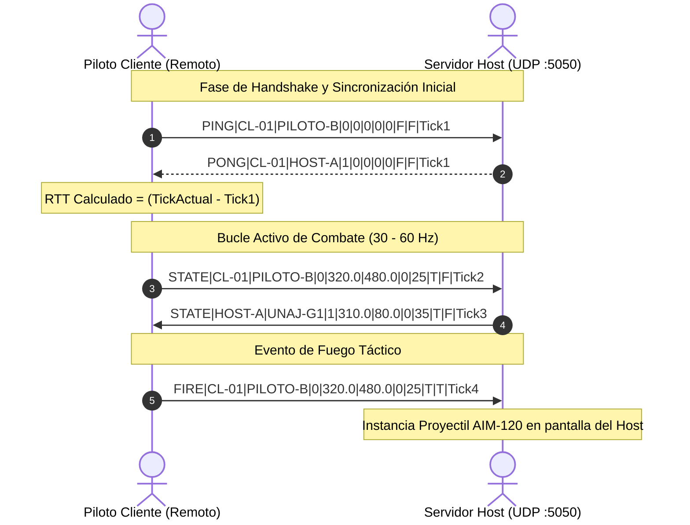

# 🌐 Especificación del Protocolo de Red UDP
# Cóndor Táctico: Tactical Air Combat Protocol (TACP v1.0)

**Versión del Protocolo:** 1.0  
**Capa de Transporte:** UDP (User Datagram Protocol) sin bloqueo  
**Codificación:** UTF-8 String delimitado por pleca / pipe (`|`)  
**Puerto por Defecto:** `5050` (Configurable en UI)  

---

## 1. Motivación y Filosofía del Protocolo

En juegos de combate aéreo en tiempo real a 60 FPS, el protocolo **TCP** introduce latencia excesiva debido a:
- La sobrecarga del saludo de tres vías (*Three-Way Handshake*).
- El bloqueo de cabeza de línea (*Head-of-Line Blocking*) cuando se pierde un paquete anterior.
- Los mecanismos de retransmisión y control de congestión lenta.

Por ello, **Cóndor Táctico** implementa un protocolo ligero sobre **UDP** donde la pérdida ocasional de un datagrama de estado es preferible a esperar una retransmisión, pues cada paquete contiene el estado cinematográfico absoluto más reciente de la aeronave.

---

## 2. Estructura de Datagrama: `PaqueteRedAeronave`

Cada mensaje viaja como una cadena de texto plana con valores separados por `|`:

```
TIPO|ID_AERONAVE|PILOTO|MODELO|POS_X|POS_Y|ANGULO|VIDA|ACEL|FUEGO|TIMESTAMP
```

### Tabla de Campos

| Índice | Campo | Tipo C# | Formato / Rango | Descripción |
| :---: | :--- | :--- | :--- | :--- |
| **0** | `TipoMensaje` | `string` | `STATE`, `FIRE`, `PING`, `PONG` | Verbo de control del paquete. |
| **1** | `IdAeronave` | `string` | Alfanumérico (GUID o Nombre) | Identificador único de la entidad en red. |
| **2** | `NombrePiloto` | `string` | Texto ($\le 16\text{ caracteres}$) | Nombre del jugador o escuadrón. |
| **3** | `Modelo` | `int` | `0` (F-35A) o `1` (B-2 Spirit) | Tipo de modelo vectorial a instanciar. |
| **4** | `X` | `float` | `0.0` a `1920.0` (formato `F1`) | Coordenada horizontal en píxeles. |
| **5** | `Y` | `float` | `0.0` a `1080.0` (formato `F1`) | Coordenada vertical en píxeles. |
| **6** | `Angulo` | `float` | `-15`, `0`, `+15` (formato `F0`) | Alabeo lateral de la aeronave. |
| **7** | `Vida` | `int` | `0` a `100` | Puntos de estructura actuales. |
| **8** | `Acelerando` | `bool` | `True` o `False` | Estado del postquemador / empuje. |
| **9** | `DisparoActivo`| `bool` | `True` o `False` | Disparo de armamento en este frame. |
| **10** | `TimestampTicks`| `long` | `Stopwatch.GetTimestamp()` | Ticks de alta resolución para RTT. |

### Ejemplo de Trama Real
```text
STATE|PILOTO-ALPHA|UNAJ-G1|1|450.5|520.0|15|35|True|False|48912039120
```
*Interpretación:* Aeronave B-2 Spirit (`1`) del piloto `UNAJ-G1`, ubicada en $(450.5, 520.0)$, virando a $+15^\circ$, con $35\text{ HP}$, postquemador encendido y sin disparar en este instante.

---

## 3. Tipos de Mensajes y Flujo de Comunicación



---

## 4. Presupuesto de Ancho de Banda (Bandwidth Budget)

- **Tamaño medio por datagrama:** $\approx 65\text{ bytes}$.
- **Frecuencia de envío:** $30\text{ Hz}$ ($30\text{ paquetes/segundo}$).
- **Consumo de subida por cliente:** $\approx 1.95\text{ KB/s}$ ($15.6\text{ Kbps}$).
- **Consumo de bajada en Host (para 4 clientes):** $\approx 7.8\text{ KB/s}$ ($62.4\text{ Kbps}$).

El consumo es tan reducido que permite operar con fluidez incluso sobre conexiones móviles lentas o redes locales universitarias saturadas.

---

## 5. Medición de RTT y Compensación de Lag

Para calcular el tiempo de retardo de ida y vuelta (**RTT - Round Trip Time**):
$$\text{Latencia (ms)} = \frac{(\text{TimestampActual} - \text{TimestampPaquete}) \times 1000.0}{\text{Stopwatch.Frequency}}$$

Esta métrica se grafica en tiempo real en el **HUD de Telemetría Táctica (`F3`)**.
