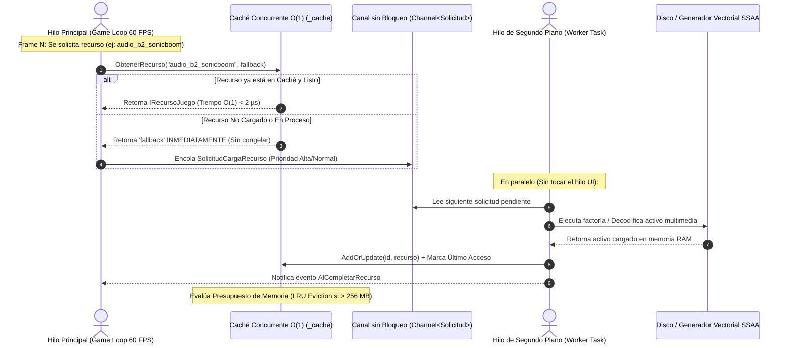

# 📦 Arquitectura de Carga Asíncrona y Streaming en Segundo Plano
# Cóndor Táctico: Non-Blocking Resource Streaming Subsystem

**Módulo:** `CondorTactico.Resources` (`GestorRecursosAsincrono`, `IRecursoJuego`, `RecursoGrafico`)  
**Plataforma:** .NET 8.0 (C# 12)  
**Institución:** Universidad Nacional de Juliaca (UNAJ)  
**Fecha:** Octubre 2026  

---

## 1. Justificación y Objetivos de Ingeniería

En videojuegos de combate en tiempo real a **60 FPS fijos**, el hilo principal de la aplicación (UI / Game Loop) dispone de únicamente **16.66 milisegundos por frame** para procesar la entrada de teclado, actualizar las trayectorias físicas, evaluar colisiones espaciales y renderizar los gráficos en pantalla.

Cualquier operación sincrónica que realice:
- Lectura de archivos desde disco (HDD/SSD/red).
- Descompresión de texturas o decodificación de audio.
- Rasterización intensiva de mallas vectoriales con **4x SSAA**.
- Deserialización de mapas y oleadas de enemigos.

Produciría congelamientos perceptibles (*micro-stuttering* y caídas a menos de 30 FPS), arruinando la precisión táctica del combate.

Para solucionar esto de manera escalable y profesional, **Cóndor Táctico** implementa un **Subsistema de Streaming y Carga Asíncrona en Segundo Plano** basado en canales sin bloqueo (`System.Threading.Channels.Channel<T>`), caché concurrente $\mathcal{O}(1)$ y política de presupuesto de memoria LRU.

---

## 2. Diagrama de Flujo del Pipeline de Streaming



---

## 3. Componentes Fundamentales de la Arquitectura

### 3.1. Contrato Unificado `IRecursoJuego`
Define la interfaz común que deben implementar todos los activos multimedia y técnicos del simulador:
```csharp
public interface IRecursoJuego : IDisposable
{
    string Id { get; }
    TipoRecursoJuego Tipo { get; }
    EstadoRecurso Estado { get; }
    long TamanoBytesAproximado { get; }
    long UltimoAccesoTicks { get; }
    void MarcarAcceso();
}
```

### 3.2. Canales sin Bloqueo (`Channel<SolicitudCargaRecurso>`)
En lugar de emplear bloqueos pesados de sincronización (`lock`, `Monitor`), el motor utiliza un canal de producción/consumo desacoplado:
- **Productores Múltiples:** Cualquier subsistema del juego puede solicitar la carga de nuevos recursos sin esperas.
- **Consumidor Único:** El hilo trabajador en segundo plano drena las solicitudes en orden de llegada o prioridad con mínima sobrecarga de CPU.

### 3.3. Mecanismo de Consulta Inmediata y *Fallback Seguro*
El método `ObtenerRecurso<T>(string id, T fallback)` nunca arroja excepciones por recursos no encontrados ni detiene la ejecución del cuadro. Si una textura, sonido o aeronave no ha completado su streaming:
1. Retorna instantáneamente un objeto *fallback* (por ejemplo, una silueta básica o sonido silencioso).
2. Automáticamente añade la tarea de carga a la cola de fondo.
3. En el momento en que el activo termina de procesarse, el siguiente frame lo utiliza de forma transparente.

---

## 4. Política de Presupuesto y Desalojo de Memoria (LRU Cache Eviction)

El motor establece un presupuesto de memoria RAM parametrizable (por defecto **256 MB**):

$$\text{MemoriaActual} = \sum_{i=1}^{K} \text{TamanoBytesAproximado}_i$$

Cuando $\text{MemoriaActual} > \text{LimitePresupuestoMemoriaBytes}$:
1. Se audita la lista de activos en caché ordenados ascendentemente por su marca temporal `UltimoAccesoTicks`.
2. Los recursos que llevan más tiempo sin ser utilizados en el combate son descartados y liberados (`Dispose()`) atómicamente.
3. El proceso de purga se detiene cuando la memoria vuelve a encontrarse por debajo del $85\%$ del presupuesto disponible, evitando recolecciones compulsivas.

---

## 5. Integración con el HUD de Telemetría Táctica (`F3`)

El estado del gestor de recursos en segundo plano es auditado en tiempo real en la pantalla de diagnóstico del simulador:

```text
🦅 CÓNDOR TÁCTICO | PROFILER [F3 HUD | F4 EXPORT]
FPS: 60.0 | CPU Total: 0.41 ms
Update(Física/IA): 42 µs | Render(GDI+): 370 µs
Big-O Colisión: Grilla O(N+K)=0 vs O(N*M)=0
Cache Sprites: O(1) Hash | N=0 Proyectiles, M=2 Naves
RAM Heap: 1.5 MB (WS:74MB) | GC:0/0/0
Streaming Bg: 16 en caché (4.82 MB) | Cola: 0
OOP Activo: BombarderoB2Spirit (DIT=3, MI=86.4)
RED: HOST SERVIDOR UDP :5050 [ACTIVO]
Ping RTT: 0.68 ms | TX:45 RX:90 (30 pkt/s)
```

---

## 6. Guía para Agregar Nuevos Recursos Futuros

### Cargar una Nueva Textura en Segundo Plano
```csharp
await GestorRecursosAsincrono.Instancia.SolicitarCargaSegundoPlano(
    "textura_camuflaje_artico",
    () => new RecursoGrafico("textura_camuflaje_artico", new Bitmap("assets/renders/camuflaje.png")),
    PrioridadCarga.Normal);
```

### Precargar un Lote Completo de Efectos de Sonido
```csharp
var loteAudio = new List<(string, Func<IRecursoJuego>, PrioridadCarga)>
{
    ("audio_misil_lock", () => CargadorAudio.CargarClip("assets/audio/lock.wav"), PrioridadCarga.Alta),
    ("audio_sonic_boom", () => CargadorAudio.CargarClip("assets/audio/boom.wav"), PrioridadCarga.Normal)
};

await GestorRecursosAsincrono.Instancia.PrecargarLoteAsincronoAsync(loteAudio);
```
